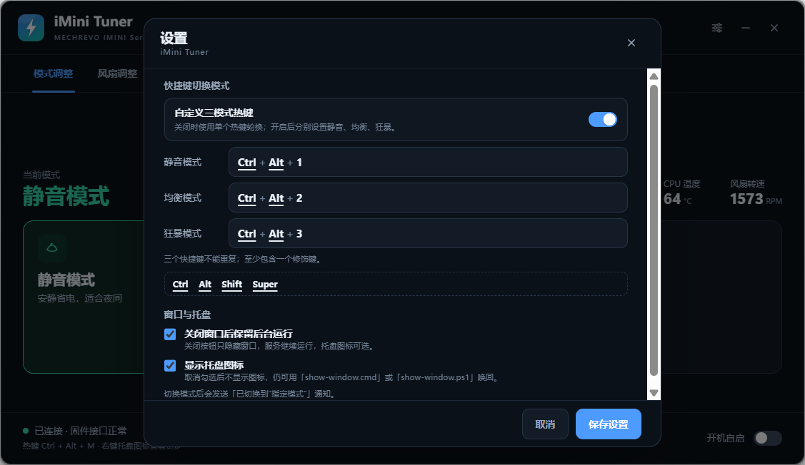
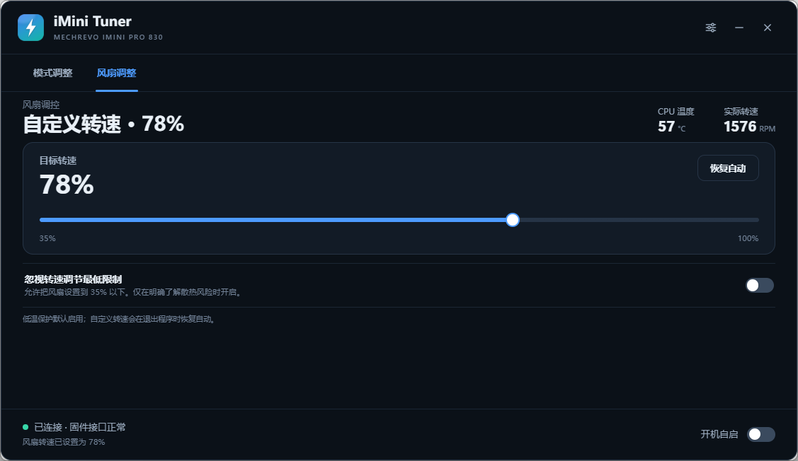
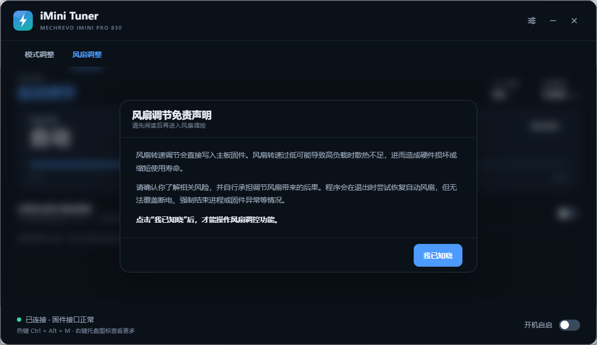

# iMini Tuner

机械革命 **imini Pro 830**（IMINI-ARB32H-HPT，Ryzen 7 8745H，无独显）的第三方控制工具。直接调用 BIOS 暴露的 ACPI-WMI 接口切换 **静音 / 均衡 / 狂暴** 模式，并提供风扇转速调节、温度保护、托盘菜单和全局热键。

> 非官方项目，与机械革命（MECHREVO）无隶属关系。切换模式与调节风扇都会直接写入固件，请先阅读[风险与兼容性](#风险与兼容性)。



## 功能

- **两个调节页**：`模式调整` 切换静音/均衡/狂暴；`风扇调整` 手动设定目标转速。
- **风扇安全机制**：默认最低 35%；解除最低限制需二次确认，硬下限 20%。温度保护默认开启，≥88°C 或检测到转速异常时自动恢复固件自动风扇。
- **免责声明**：第一次进入风扇页时模糊风扇区域，必须点击「我已知晓」才能操作；未确认时仍可切回模式页。
- **系统托盘**：左键显示主界面，右键菜单可切模式、设置、开机自启、退出。
- **机型识别**：标题栏读取当前主板型号；风扇页在非已验证机型上显示「未在当前机型下验证该功能可用性，请自行测试」。
- **全局热键**：可在「轮换模式」与「自定义三模式」之间切换。轮换默认 `Ctrl + Alt + M`；自定义默认为 `Ctrl + Alt + 1/2/3`，每个热键都必须包含至少一个修饰键。
- **低占用后台**：Rust 后端常驻固件桥接；界面隐藏 30 秒后销毁 WebView2 渲染进程，重新显示时自动创建。
- **明暗主题**：跟随 Windows 应用主题，运行时切换立即生效。





## 三个版本

| 版本 | 文件 | 说明 |
| --- | --- | --- |
| 单文件便携版 | `iMiniTuner-Lite.exe` | 双击即用。不含开机自启、托盘、全局热键和设置页；关闭主界面即退出全部进程。 |
| 单文件安装版 | `iMiniTuner-Setup.exe` | Inno Setup 向导，安装到 Program Files，创建开始菜单和可选桌面快捷方式。功能完整。 |
| 压缩包便携版 | `iMiniTuner-Portable.zip` | 解压即用，功能完整；设置保存在程序同目录的 `imini-settings.json`。 |

完整版（安装版 / 压缩包版）包含模式页、风扇页、托盘、热键和设置页；开机自启仅限安装到 Program Files 的安装版，以避免提权路径被重定向。Lite 版适合临时使用、远程维护或不想改系统的场景。

## 使用

### 模式调整

点击三张模式卡片之一。切换过程会显示「正在切换到“…”」缓冲动画；完成后界面和通知显示「已切换到“指定模式”」。

### 风扇调整

1. 点击「风扇调整」页，阅读免责声明并点击「我已知晓」。
2. 拖动目标转速滑块，或点击「恢复自动」。
3. 需要低于 35% 时，打开「忽视转速调节最低限制」，在警告弹窗中确认「仍然开启」；滑块下限变为 20%。
4. 打开最低限制后才会显示「温度保护」。建议保持开启。

> 程序退出时会尝试恢复自动风扇，但无法覆盖断电、强制结束进程、蓝屏或固件异常。自定义低速运行后请确认散热正常。

### 设置

- **快捷键切换模式**：选择「轮换模式」只录一个热键，按静音 → 均衡 → 狂暴轮换；选择「自定义三模式」可分别设置静音、均衡、狂暴三个热键。
- **修饰键要求**：每个热键至少包含 `Ctrl`、`Alt`、`Shift` 或 `Super` 之一；输入框下方的修饰键名称带下划线，鼠标悬停会显示定义。
- **关闭窗口后保留后台运行**：关闭按钮只隐藏窗口。
- **显示托盘图标**：不勾选时不显示托盘图标，但后台继续运行；用程序目录的 `show-window.cmd` / `show-window.ps1` 唤回界面。
- 只有关闭「保留后台运行」时，关闭窗口才结束进程。
- 连续快速切换时，新通知会替换旧通知，避免旧模式提示覆盖新模式。

## 下载与安装

发布包在 [Releases](../../releases/latest)。

- 安装版：双击 `iMiniTuner-Setup.exe`，按向导完成。安装目录包含 `show-window.cmd`、`show-window.ps1` 和 `README.md`。
- 压缩包版：解压后运行 `iMini Tuner.exe`。设置写入同目录的 `imini-settings.json`；请放在可写目录，不要只读挂载。
- Lite：直接运行 `iMiniTuner-Lite.exe`，关闭窗口即退出。

程序需要管理员权限（访问 ACPI-WMI 实例）。安装版通过清单请求提升；便携版首次启动也会请求 UAC。

发布包使用项目自签名证书签名，`release/` 中附 `iMiniTuner-SelfSigned.cer`。自签名证书没有 Microsoft 的发布者信誉，所以首次双击安装包时 SmartScreen 仍会提示“无法识别的应用”：点“更多信息”→“仍要运行”，再确认 UAC 即可。这一步无法靠自签名消除，只有受信任的代码签名证书（OV/EV）才能免提示。

核对签名：右键安装包 → 属性 → 数字签名。若希望本机把发布者显示为 iMini Tuner，可导入随包证书：

```powershell
Import-Certificate .\iMiniTuner-SelfSigned.cer -CertStoreLocation Cert:\CurrentUser\Root
Import-Certificate .\iMiniTuner-SelfSigned.cer -CertStoreLocation Cert:\CurrentUser\TrustedPublisher
```

## 命令行

```text
"iMini Tuner.exe" --show          # 启动并显示界面
"iMini Tuner.exe" --minimized     # 启动到托盘（完整版且显示托盘时）
"iMini Tuner.exe" --quit          # 退出正在运行的实例
iMiniTuner-Lite.exe --show        # Lite 启动并显示
```

界面隐藏 30 秒后 WebView2 会被释放；用 `show-window.ps1` / `show-window.cmd` 或托盘图标唤回。若托盘也已隐藏，脚本通过命名事件通知正在运行的后台进程创建新窗口。

## 风险与兼容性

**已验证机型**：MECHREVO IMINI Series / IMINI-ARB32H-HPT，Ryzen 7 8745H，BIOS IMINI Series 1.12，Windows 11 26200。

- 不同机型/BIOS 的 ACPI-WMI 方法可能不同。非本机型请先以管理员身份运行，确认界面能读取温度/转速后，再尝试切换或调节风扇。
- 风扇转速写入直接作用于 EC/固件；过低的转速可能导致高负载过热。程序提供 20% 硬下限和 88°C 温度保护，但不能替代硬件保护。
- 关闭温度保护、强制结束进程或固件异常时，程序无法保证恢复自动风扇。
- 界面释放 WebView2 后，首次重新显示会有短暂创建延迟；后台模式切换和热键仍由 Rust 后端工作。

## 实现说明

### 固件接口

CPU 模式和风扇都通过 ACPI-WMI 暴露的 `root\WMI` → `PowerSwitchInterface` 实例 `ACPI\PNP0C14\IP3POWERSWITCH_0`：

| 方法 | 用途 |
| --- | --- |
| `SetPowerMode(PowerMode)` | 0 均衡 / 1 狂暴 / 2 静音 |
| `GetPowerMode()` | 读取当前模式 |
| `GetFanControl(FanNumber)` | 读取风扇占空比；低 16 位为 RPM |
| `SetFanControl(FanDuty, FanNumber)` | 101 = 自动；20–100 = 手动百分比 |
| `GetHwTemp(HwTempType=1)` | CPU 温度；其它类型返回无效哨兵 |

Tauri/Rust 主程序负责 UI、托盘、热键、窗口生命周期和安全策略。固件调用由内嵌的轻量 C# 桥接程序 `imini-power-210.exe` 完成：它以 `--serve` 常驻，Rust 通过 stdin/stdout 发请求，避免每次滑块都新建进程和 WMI 连接。桥接程序只释放到 `%ProgramData%\iMiniTuner\run-*\`，该目录仅 SYSTEM 和 Administrators 可访问，并在写入后校验字节；不会从用户可写目录加载可执行文件。

### 界面释放

主窗口隐藏后启动 30 秒计时；若仍未显示，就销毁 WebView2 窗口（保留 Rust 进程、托盘、热键和固件桥接）。`show_main` 重新创建窗口并加载同一套 `ui/` 资源。

### 构建

需要 Windows、.NET Framework 4.x 的 `csc.exe`、Rust 1.77+、VS Build Tools（MSVC + Windows SDK）。

```bat
build-tauri.ps1 -Edition full     -OutDir dist         -Name "iMini Tuner.exe"
build-tauri.ps1 -Edition portable -OutDir dist-portable -Name "iMini Tuner.exe"
build-tauri.ps1 -Edition lite     -OutDir dist         -Name "iMiniTuner-Lite.exe"
build-installer.ps1
build-release.ps1
```

`build-release.ps1` 构建三个版本、Inno Setup 安装包，并组装 `release/`；若存在 `certs\imini-tuner-selfsigned.pfx`，会在打包前自动签名三个 exe 和安装包（`sign-release.ps1`，需要 Windows SDK 的 `signtool.exe`）。安装包需要 Inno Setup 6（`ISCC.exe`）。

## 文件结构

```text
src-tauri/            Tauri/Rust 后端、托盘、热键、风扇安全、窗口释放
  src/helper.rs       常驻固件桥接
  src/autostart.rs    计划任务开机自启
  src/wake.rs         show-window 命名事件
ui/                   模式页、风扇页、免责声明、设置
hotkey-helper/        快捷键录制辅助进程（独立 Win32 消息循环）
helper/               C# 固件桥接源码
installer/            Inno Setup 脚本与安装版 README
certs/                自签名代码签名证书与口令（仅本机，勿外发）
src/                  旧版 WinForms 源码（保留参考，不参与 Tauri 构建）
docs/                截图与逆向说明
```

## 安全

程序需要管理员权限，因此把辅助程序放在 `%ProgramData%\iMiniTuner` 的 SYSTEM/Administrators 专属目录，限制开机自启只能指向 Program Files 中的安装版，并对 WebView 启用 CSP。完整威胁模型、已修复问题和残余风险见 [安全审查](docs/security-audit.md)。

发布包使用自签名证书签名，证书随包放在 `release/iMiniTuner-SelfSigned.cer`。签名只能证明文件来自本项目、未被篡改；自签名证书没有 Microsoft 发布者信誉，SmartScreen 首次仍会提示。请只从本仓库 Releases 下载，并核对 `SHA256SUMS.txt`。

## 反馈与许可

问题和兼容性报告请使用 GitHub Issues，并附上机型、BIOS、Windows 版本和 `%LOCALAPPDATA%\iminiControlCenter\app.log`。

MIT License，见 [LICENSE](LICENSE)。
